  

Backend developer building robust, scalable solutions with Python, and Android apps with Kotlin and Jetpack Compose.

## Projects

<table>
  <tr>
    <td width="80" align="center"></td>
    <td>
      <a href="https://github.com/mmVohid/Uploat-V"><b>Uploat-V</b></a> — a lightweight video downloader for Android. 
      Kotlin · Jetpack Compose · yt-dlp 
      <a href="https://github.com/mmVohid/Uploat-V/releases/latest">Download APK</a> · <a href="https://github.com/mmVohid/Uploat-V">Source</a>
    </td>
  </tr>
  <tr>
    <td width="80" align="center"><a href="https://github.com/mmVohid/V-Toolkit">🛠️</a></td>
    <td>
      <a href="https://github.com/mmVohid/V-Toolkit"><b>V-Toolkit</b></a> — a single-file Windows admin / DevOps batch toolkit with Uzbek and English UI. 
      Batch · Windows 
      <a href="https://github.com/mmVohid/V-Toolkit">Source</a>
    </td>
  </tr>
</table>

## Contact

## Tech Stack

  
Made with ❤️ by <strong>mmVohid</strong>

