  

 

  <h2>Contact</h2>
  Questions, ideas or feedback — I read everything.

 

<table align="center">
  <tr>
    <td></td>
    <td></td>
    <td></td>
  </tr>
</table>

 

  <h2>Projects</h2>

<table align="center">
  <tr>
    <td align="center">
       
      <a href="https://github.com/mmVohid/Uploat-V/releases/latest"><b>Download APK</b></a> · <a href="https://github.com/mmVohid/Uploat-V">Source</a>
    </td>
    <td align="center">
       
      <a href="https://github.com/mmVohid/V-Toolkit"><b>Source</b></a>
    </td>
  </tr>
</table>

 

  <h2>Stack</h2>
  

 

  

